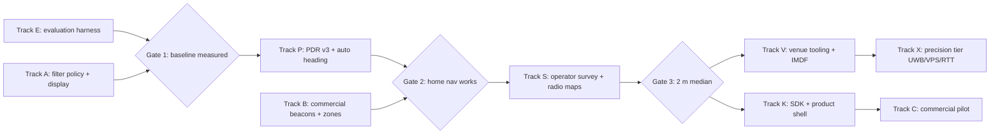

# Plan 002: TURN master plan (positioning that works → commercial product)

Status: ACTIVE (2026-10-18). Supersedes the task list in [the 16 Oct assisted-navigation plan](2026-10-16-assisted-navigation-master-plan.md); its research stays valid. Every task here is written so any agent or model can pick it up cold. Tick `[x]` only when the acceptance check has actually been run, and record the evidence in the task's "Done" line.

---

## 0. How to use this plan (read first, every agent)

- [ ] Read [AGENTS.md](../../AGENTS.md), [PROJECT_STATE](../../docs/PROJECT_STATE.md), [positioning STATUS](../../docs/workstreams/positioning/STATUS.md), [mobile STATUS](../../docs/workstreams/mobile/STATUS.md), [ADR-0009](../../decisions/0009-particle-filter-fusion.md) and [platform constraints](../../docs/PLATFORM_CONSTRAINTS.md) before touching code.
- **One task per branch/PR**, named `task/<ID>-short-name`. Never mix two task IDs in a commit.
- **Algorithms live in packages** (`positioning-core`, `pdr`, `routing`, `venue-model`), never in React screens. Live and replay share the same code path.
- **Every positioning change is measured**: replay the evaluation dataset (task E1) before and after, and paste the numbers into the PR. No number means the task is not done.
- **Never claim accuracy from synthetic tests.** Synthetic tests prove mechanics; only labelled real walks prove accuracy.
- Keep SDK 57. JavaScript-only changes reload over Metro. Native changes need Android build N+1 and the iPhone CI IPA ([iOS build](../../docs/IOS_TEST_BUILD.md)).
- Run `npm run check` (types, tests, lint, format, doc links) and `npm run export:web` before every commit.
- Raw recordings stay in ignored `work/`; never commit private venue data or identifiable traces.
- When a task changes a decision, add or update an ADR; when it finishes, update the relevant STATUS file.

**Known WIP:** `git stash list` → `WIP assist-v2 policy`. It contains a typechecked but untested start of tasks A1 and A2 (`assist-fusion.ts`, radio gating in `fusion.ts`, `replayAssist`). Apply it with `git stash apply` when starting A1, or discard it deliberately.

---

## 1. Where we are (facts, 18 Oct)

**Works:**

- Maps-style UI with search, a route, a blue dot and a beacon layout editor.
- A particle filter with walls, radio and drift states, plus a trace recorder and replay.
- Native BLE streams on Android build 5 and the iPhone CI build.
- An upload inbox and analysis script (`npm run analyze:ble`).

**Fails at home** (six recorded walks, see [plan 001 diagnosis](2026-10-16-assisted-navigation-master-plan.md) and positioning STATUS):

1. **Phone-beacon signal is weak:** about −72 to −81 dBm at 1 m, against −55 to −65 for a real beacon. Ranging is noise beyond about 3 m.
2. **Beacons almost collinear:** x = 6.4, 8.1 and 7.4 m, so there is no left–right information. Too few beacons (3 for about 400 m²).
3. **Walking engine (PDR) often absent:** 3 of 5 walks had 0–1 walking updates. It stops on tilt or gaps, needs manual heading alignment and uses a fixed step length.
4. **Overconfident filter:** it reports ±1 m while metres off; radio is applied every second as independent evidence; proximity fixes fire with one beacon heard.
5. **Raw jitter displayed:** the dot moves about 0.9 m/s (p90) while standing still.
6. **No ground truth:** improvements can't be measured.

**User decisions:**

- Buy commercial BLE beacons.
- iPhone and Android must work equally, phone held in the hand.
- End users never survey; venue setup (us, later venue staff) does the surveys.

---

## 2. Target architecture (what "done" looks like)

```
 Sensors (native)            Signals (pure TS)            Estimation (pure TS)          Product
 ─────────────────           ─────────────────           ────────────────────         ─────────
 IMU 50–100 Hz  ───►  PDR v3: steps, stride, heading ─┐
 Magnetometer   ───►  magnetic features ─────────────┤
 BLE stream     ───►  beacon identity + RSSI windows ├──►  AssistFusion policy ──► particle filter ──► snapped, smoothed pose ──► guidance, UI, SDK
 (Wi-Fi RTT/UWB)───►  optional ranges ────────────────┤      (when to apply what)     (walls, drift states)
 User/QR/VPS    ───►  absolute fixes ─────────────────┘
                         ▲                                          │
 Venue package: map, routing graph, beacon layout, radio/magnetic maps (from operator survey)
                         ▲                                          ▼
 Operator tools: floor-plan import, beacon placement, survey walks   Recorder → inbox → replay → evaluation leaderboard
```

Principles:

- **Motion is the backbone.** Radio and magnetic data correct it.
- **Fingerprints over formulas.** Measured maps beat a path-loss model.
- **Honest uncertainty.** Never claim better than the evidence supports.
- **Every release is replayed against labelled walks.**

---

## 3. Flow and gates



| Gate       | Pass criteria (measured on labelled walks, both phones)                                                                    |
| ---------- | -------------------------------------------------------------------------------------------------------------------------- |
| G1         | Dataset of ≥ 10 labelled walks exists; current system's error and failure numbers recorded as the baseline.                |
| G2         | Navigation completes with no manual fix in ≥ 8/10 home walks; dot never drifts > 0.3 m while standing; no silent PDR stop. |
| G3         | Median error ≤ 2 m and p90 ≤ 4 m at landmarks; correct room ≥ 95%; arrival ≥ 9/10.                                         |
| G4 (pilot) | Same as G3 in a second, unfamiliar venue after a setup of under 2 hours.                                                   |

Parallelism: E, A and B1 (ordering) can start immediately in parallel. P needs E's dataset to prove itself. S needs B's beacons and P.

---

## 4. Tracks and tasks

Size: S ≤ 0.5 day, M 1–2 days, L 3–5 days (agent effort). "Files" are the expected touch points.

### Track E: evaluation and ground truth (do first; everything depends on it)

- [ ] **E1. Labelled walk recording.** (M) Add landmark taps during navigation: "I'm at <landmark>" quick buttons and a floor-mark mode. They write timestamped `checkpoint` annotations into both the navigation recording and the `ble-trace`. Reuse `appendCheckpoint` (`positioning-core/src/checkpoints.ts`).
  - Files: `apps/mobile/src/app/index.tsx`, `navigation/assisted-tracker.ts`, `ble-proximity.ts` (schema: optional `landmarks[]`).
  - Accept: a recorded walk has ≥ 4 landmarks with venue coordinates; schema round-trips; older traces still parse.
- [ ] **E2. Physical ground truth kit.** (S, docs) Print and place 8–12 numbered floor markers (tape plus QR) at map-known points: doors, room centres, corridor turns. Measure their positions against the plan, and record them in the private venue as `landmarks` with a measured accuracy note.
  - Accept: a marker table with coordinates exists in `work/private`; a doc explains placement.
- [ ] **E3. Evaluation runner and leaderboard.** (M) `npm run eval` replays every labelled trace in `work/eval/` through the current code. Per trace and overall it reports:
  - error at landmarks (median, p90);
  - correct-room rate;
  - drift while standing;
  - arrival success;
  - time to first fix.
    It writes `work/eval/results-<git-sha>.json` and prints a diff against the previous run.
  - Files: `scripts/eval.mjs`, `positioning-core/src/fusion-replay.ts`.
  - Accept: runs on the six existing traces (no labels yet means stability metrics only) and on labelled ones.
- [ ] **E4. Regression gate in CI (later).** (S) Keep a small public synthetic plus anonymised dataset in the repo; CI fails if metrics regress by more than 10%.
- [ ] **E5. Protocol doc.** (S) `docs/EVALUATION.md`: routes to walk (5 fixed routes plus 2 random), phones, carry modes (flat in hand, tilted reading, swinging hand), lighting/crowd notes, how to label, what to send.

### Track A: filter policy, honesty and display (fixes what you saw)

- [ ] **A1. AssistFusion policy shared by live and replay.** (M) One pure class decides when evidence is applied (the stash contains a start).
  - Radio updates every 3 s, only after ≥ 1 m of walking (except 3 settle updates after a cold start).
  - Tempered (0.6) heavy-tailed likelihood, σ 9 dB.
  - Innovation gate: skip updates no hypothesis explains (2.5σ).
  - Proximity fixes need ≥ 2 beacons heard, σ 2.5 m.
  - Displayed uncertainty floored at 1.5 m.
  - Files: `positioning-core/src/assist-fusion.ts`, `fusion.ts`, `fusion-replay.ts`; the mobile tracker becomes a thin wrapper.
  - Accept: unit tests; replay of the six traces shows drift while standing ≤ 0.3 m per minute (from metres) without losing walking corrections; record before/after numbers.
- [ ] **A2. Never move without evidence.** (S) The displayed position changes only on a walking step, an applied radio update, a proximity/fingerprint fix or a user fix. Show an "estimating…" state rather than wandering.
- [ ] **A3. Maps-grade display.** (M)
  - Snap to the route polyline when within 2 m and moving along it.
  - Otherwise snap to the walkable centreline (medial-axis graph from `venue.edges`).
  - Animate between positions (200–400 ms ease).
  - Heading cone smoothed; optional heading-up rotation.
  - Accuracy halo from the displayed uncertainty.
  - Files: `components/nav-map.tsx`, `navigation/assist-helpers.ts`.
  - Accept: helper tests; browser-pane visual check; no jumps above 1.5 m between frames unless a fix occurred.
- [ ] **A4. Confidence-driven UX.** (S) When uncertainty is above 4 m for 10 s, show "Not sure where you are", offer "Tap your spot" and keep guidance paused. When it recovers, resume. Never give turn instructions with high uncertainty.
- [ ] **A5. Rerouting hygiene.** (S) Reroute only when off-route for 4 s and uncertainty is under 3 m; debounce; count reroutes in the trace.

### Track P: PDR v3, the motion backbone (largest lever)

- [ ] **P1. Orientation-independent step detection.** (L) Detect steps from the gravity-removed acceleration magnitude (or vertical component in the earth frame using attitude): band-pass 1–3 Hz, adaptive peak threshold, 0.25–1.0 s refractory. Works flat, tilted and swinging in hand. Keep `step-yaw-motion-v2` for historical replay; add a new revision `step-v3`.
  - Files: `packages/pdr/src/*`, `positioning-core/src/engine.ts` (new path), `motion-guard.ts` (soft, not stopping).
  - Accept: on recorded walks (inbox runs with manual footfall counts, see `research/MOTION_GUARD_EXPERIMENT.md`), count error ≤ 5% for normal pace on both phones; bobbing control produces ≤ 2 false steps per 20 s.
- [ ] **P2. Never stop; degrade.** (M) Replace hard stops (tilt over 60°, heading gap, clock issues) with soft states: hold position, widen uncertainty, resume automatically. Only permission/hardware loss stops, with a visible reason.
  - Accept: replay of historical failing runs shows no stops except hardware loss.
- [ ] **P3. Heading from attitude.** (M) Heading = yaw of the device's forward axis projected to the horizontal plane from the full attitude quaternion/rotation matrix, not raw alpha. Use the Android rotation vector (magnetometer-fused, absolute) and, on iOS, DeviceMotion with a magnetic-north reference where available (check SDK 57 docs; otherwise a native module change in M2). Add gyro-only short-term smoothing.
- [ ] **P4. Automatic map alignment, no "face the route" step.** (M)
  - Store a per-venue map-north offset (venue frame vs magnetic north), learned once during the operator survey (S2) or a guided calibration walk.
  - With absolute heading available, start immediately.
  - Without it, initialize the filter's heading-bias state uniformly over 360° and let walls, the route and beacons resolve it within 5–10 m.
  - Add magnetic disturbance detection: when field magnitude deviates more than 15% from local Earth, trust the gyro, not the compass.
  - Accept: start-to-correct-heading within 10 m on ≥ 8/10 walks without manual alignment.
- [ ] **P5. Stride model.** (M) Weinberg/frequency-based step length with a per-user scale learned online from the filter's scale state, then persisted. Remove the mandatory calibration screen.
  - Accept: distance error ≤ 8% on a 20 m straight after one walk of learning.
- [ ] **P6. Carry-mode classifier (later).** (M) Hand-flat, hand-tilted, swinging, pocket. Choose the step and heading strategy per mode.

### Track B: commercial beacons and robust radio use

- [ ] **B1. Procure beacons (human task).** Buy 8 beacons with:
  - transmit power configurable up to +4 dBm;
  - 100 ms interval;
  - Eddystone-UID (and iBeacon) support;
  - USB/mains or a 2+ year battery;
  - app-configurable settings.
    Prefer a vendor with a published SDK/config app. Note: iOS hides iBeacon frames from CoreBluetooth, so Eddystone-UID is the cross-platform frame.
- [ ] **B2. Eddystone-UID adapter.** (M, native) Parse service 0xFEAA, frame type 0x00 (namespace plus instance) in `TurnBleModule.kt` and `TurnBleModule.swift` into `{t, tag, rssi}`, with tag = short instance ID mapped in the venue. Keep TURN phone beacons. Add a filter so only configured namespaces are recorded (privacy).
  - Needs: Android build 6 and the iPhone CI IPA.
  - Accept: both phones list commercial beacons in Beacons → Listen.
- [ ] **B3. Placement planner v2.** (M) Replace farthest-point node sampling with geometry-aware optimisation over walkable space:
  - maximise the minimum number of beacons heard (≥ 3, target 4) under a wall-attenuation model (–4 dB per wall);
  - penalise collinearity (GDOP);
  - prefer room centres and corridor ends at about 2 m height.
    Show a coverage heatmap on the map. Files: `positioning-core/src/beacon-plan.ts`, `components/beacon-layout.tsx`.
  - Accept: for the house, ≥ 3 beacons predicted at 90% of walkable points with 8 beacons; no three sites within 1 m of a line.
- [ ] **B4. Room-zone classifier.** (M) Strongest-beacon-per-room with hysteresis (3 dB, 2 s) and a "between rooms" state. It constrains the filter softly (particles outside the room's polygon down-weighted). Robust even with weak beacons.
  - Accept: correct room ≥ 95% on labelled walks (E3).
- [ ] **B5. Device RSSI offset calibration.** (S) A per-phone-model offset learned from beacon proximity during setup or the survey, so an iPhone survey works for Android users and vice versa.
- [ ] **B6. Beacon health and fleet.** (S) Last-seen and battery (Eddystone-TLM) per beacon, and a warning when a beacon is missing or moved (its RSSI profile changed versus the survey).

### Track S: operator survey and fingerprint maps (the competitor technique)

- [ ] **S1. Survey mode (operator only).** (L) A hidden "Venue setup" area. The operator picks a route on the map and walks it at a steady pace, tapping at each node. The app records BLE windows plus magnetic vectors (in the earth frame) every 0.5 m, interpolated along graph edges by time between taps. Store them as a versioned `radio-map` in the venue's private data, and upload.
- [ ] **S2. Radio-map likelihood.** (L) In the particle filter, for each particle, compare live BLE windows with the radio map at the particle's position: kNN or Gaussian on stored mean/std per beacon. This replaces or augments the path-loss model when a map exists, and cancels transmit-power and wall effects.
- [ ] **S3. Magnetic sequence matching.** (L, EXPERIMENT) Compare the last 3–5 m of magnetic magnitude and vertical component against map sequences along candidate paths (the IndoorAtlas approach). Use it as a particle likelihood. Verify the benefit with E3 before enabling by default.
- [ ] **S4. Survey QA.** (S) Coverage report (which edges are surveyed, sample density, per-beacon visibility) and a re-survey prompt when beacons change.
- [ ] **S5. Cross-device survey.** (M) Survey with one phone family, apply the B5 offsets for the other; verify with E3 on both.

### Track V: venue model and tooling (commercial foundation)

- [ ] **V1. Adopt IMDF/GeoJSON as the venue interchange.** (L) Import and export Apple's Indoor Mapping Data Format (levels, units, openings, amenities, anchors) and keep the internal `VenuePackage` as a compiled form. Add georeferencing (lat/lon plus rotation), which also gives map north for P4.
- [ ] **V2. Floor-plan import tool.** (L) Web tool: upload a plan image, scale with two points, trace rooms and walls (with AI-assisted vectorisation as an experiment), auto-generate the walkable graph (medial axis plus door connectors), place POIs and beacons, and export a venue package.
- [ ] **V3. Venue package versioning and validation.** (S) Revision, signatures/hashes, validation (`npm run venue:validate` already exists, so extend it to beacons, radio maps and landmarks).
- [ ] **V4. Multi-floor.** (L) Barometer floor-change detection, stairs/lift connectors in routing, and floor-switching UI.

### Track K: SDK and product shell

- [ ] **K1. Positioning SDK boundary.** (M) `@turn/sdk`: `startPositioning(venue)`, `onLocation(cb)` (with uncertainty and floor), `route(to)`, `stop()`; no React. The demo app consumes it.
- [ ] **K2. Native SDK wrappers.** (L, later) Thin Swift/Kotlin wrappers for non-React apps.
- [ ] **K3. Accessibility.** (M) Voice guidance (expo-speech), turn haptics, screen-reader labels, step-free routing toggle (already in routing), large-text banner.
- [ ] **K4. Privacy and safety.** (S) On-device only by default; opt-in telemetry; retention limits; the "position is an estimate" statement; no tracking of non-TURN devices (already enforced).
- [ ] **K5. Battery and thermal budget.** (S) Measure the scan and IMU cost per hour on both phones; duty-cycle radio when stationary.
- [ ] **K6. Telemetry pipeline (opt-in).** (M) Anonymised quality metrics per venue (fix rate, uncertainty, reroutes) for operators; no raw tracks without consent.

### Track X: precision tier (optional, after G3)

- [ ] **X1. UWB experiment (Android first).** Two or three Qorvo/Estimote UWB anchors plus the Android UWB API on a UWB phone; ranges into the particle filter as time-of-flight likelihoods. iPhone requires Apple's Nearby Interaction accessory entitlement, so check access first.
- [ ] **X2. Camera relocalization.** ARKit/ARCore with a scanned venue map (or a commercial VPS: MultiSet, Immersal, Niantic) as a "Find me" and drift reset. Camera on only briefly.
- [ ] **X3. Wi-Fi RTT (Android).** Use RTT-capable routers, if present, as ranges.

### Track C: commercial path

- [ ] **C1. Positioning claims policy.** Publish only measured numbers (from E3), with conditions.
- [ ] **C2. Pilot venue.** A second building (small office or clinic): measure the time to set up and G4.
- [ ] **C3. Packaging.** Pricing model (per venue or per seat), deployment guide, beacon kit bill of materials, support runbook.
- [ ] **C4. Competitive watch.** A quarterly update of `research/` on Bluetooth Channel Sounding phone support (iOS 27, Android 16), which would replace RSSI with ranging.

---

## 5. Blind spots a professional team would also cover

- **Ground truth before tuning.** Without E1–E3, every "improvement" is opinion.
- **Map accuracy is positioning accuracy.** A 1 m error in the floor plan is a 1 m error in the dot. Verify doors and corridor widths physically (E2).
- **Phone diversity.** RSSI offsets, IMU noise and magnetometer quality differ by model; test on at least one mid-range Android.
- **Carry and behaviour.** People look at the phone, then lower it, pocket it or walk while texting. PDR must survive these transitions (P2, P6).
- **Magnetic disturbances.** Fridges, steel and laptops near the phone (P4 detection).
- **People are radio obstacles.** A body between phone and beacon costs about 5–10 dB. Expect worse numbers when crowded; the walk survey should include normal occupancy.
- **Beacon logistics.** Batteries, theft, moving, accidental reconfiguration. Detection (B6) and a re-survey process (S4).
- **Security.** Static beacon IDs can be spoofed. For commercial use, rotating or ephemeral IDs, or signed venue configs.
- **Performance.** 500 particles with wall tests in JavaScript on low-end phones; profile it, and move hot loops to typed arrays or a native module if needed (K5).
- **Start-up experience.** Time to first fix matters more to users than the last metre (E3 metric).
- **Interop and standards.** IMDF (V1) avoids lock-in and lets venues reuse Apple Maps indoor data.
- **Legal and accessibility compliance** for public venues (K3, K4).

---

## 6. Immediate next 10 working steps (ordered)

1. [ ] B1: order beacons (human, today).
2. [ ] E2: place 8–12 floor markers at home and measure them (human, 1 hour).
3. [ ] E1 + E5: landmark taps and the evaluation protocol.
4. [ ] A1 + A2: AssistFusion policy; measure drift while standing on the six existing traces.
5. [ ] E3: eval runner. Record walks with landmarks as baseline (Gate G1).
6. [ ] P2 + P3: never-stop PDR and attitude heading.
7. [ ] P1 + P5: orientation-independent steps and the stride model. Re-run eval.
8. [ ] A3 + A4: snapped, smoothed display and confidence UX.
9. [ ] B2 + B3 + B4: Eddystone adapter (native rebuild), placement v2, room zones once the beacons arrive. Re-run eval (Gate G2).
10. [ ] S1 + S2: operator survey and radio-map likelihood. Re-run eval (Gate G3).

## Completion record

(Fill in per gate: date, git SHA, eval results file, phones, notes.)
